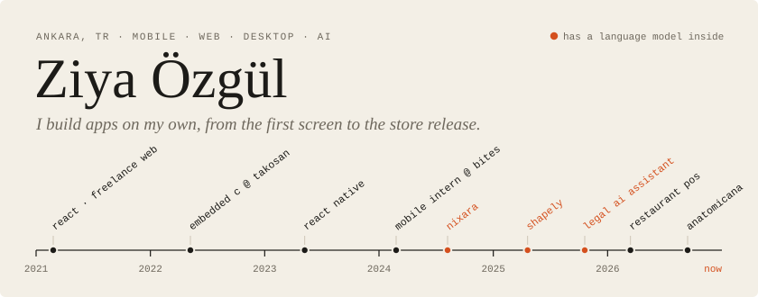
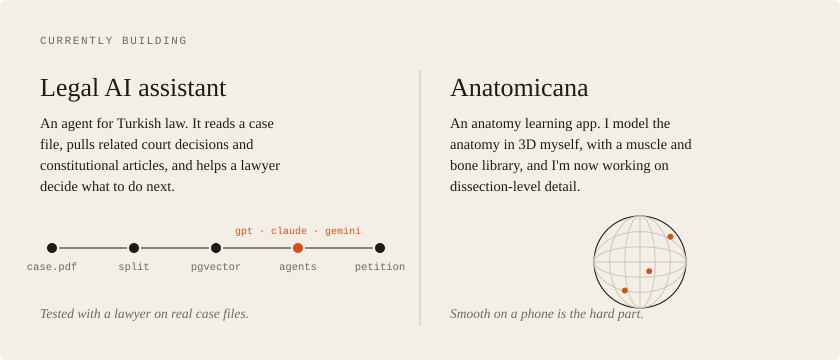
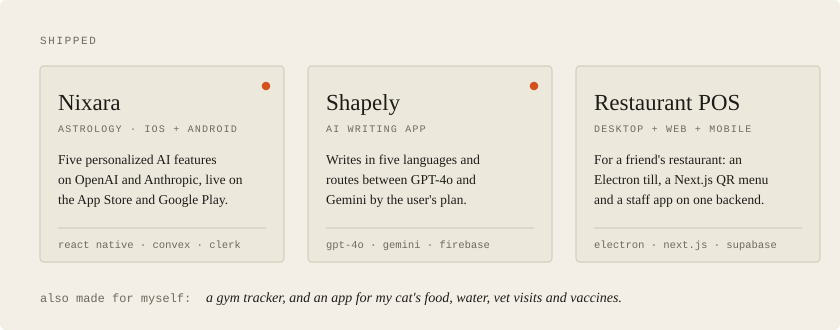
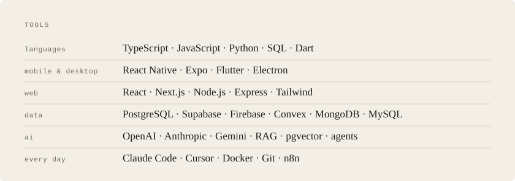

<picture>
  <source media="(prefers-color-scheme: dark)" srcset="https://raw.githubusercontent.com/ZiyaOzgul/ZiyaOzgul/main/assets/header-dark.svg"/>
  
</picture>

<picture>
  <source media="(prefers-color-scheme: dark)" srcset="https://raw.githubusercontent.com/ZiyaOzgul/ZiyaOzgul/main/assets/now-dark.svg"/>
  
</picture>

<picture>
  <source media="(prefers-color-scheme: dark)" srcset="https://raw.githubusercontent.com/ZiyaOzgul/ZiyaOzgul/main/assets/shipped-dark.svg"/>
  
</picture>

<picture>
  <source media="(prefers-color-scheme: dark)" srcset="https://raw.githubusercontent.com/ZiyaOzgul/ZiyaOzgul/main/assets/tools-dark.svg"/>
  
</picture>

[ziya-özgül.com](https://ziya-özgül.com) · [linkedin](https://linkedin.com/in/ziyaozguldeveloper)

<picture>
  <source media="(prefers-color-scheme: dark)" srcset="https://raw.githubusercontent.com/ZiyaOzgul/ZiyaOzgul/output/github-contribution-grid-snake-dark.svg"/>
  
</picture>
