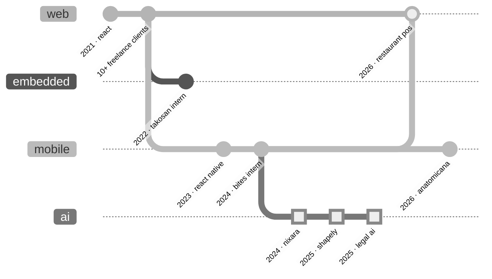
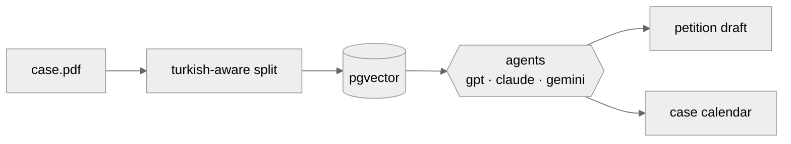

<h1 align="center">Ziya Özgül</h1>

  <i>I build apps on my own, from the first screen to the store release.</i> 
  ANKARA, TR &nbsp;·&nbsp; MOBILE &nbsp;·&nbsp; WEB &nbsp;·&nbsp; DESKTOP &nbsp;·&nbsp; AI

  <a href="https://ziya-özgül.com">ziya-özgül.com</a> &nbsp;·&nbsp; <a href="https://linkedin.com/in/ziyaozguldeveloper">linkedin</a>

 

### the road so far

highlighted commits have a language model inside.

 

### currently building

**Legal AI assistant**: an agent for Turkish law. It reads a case file, pulls related court decisions and constitutional articles, and helps a lawyer decide what to do next.

> Tested with a lawyer on their real case files. Most of what broke wasn't the prompts. It was how Turkish words got split before retrieval.

**Anatomicana**: an anatomy learning app. I'm modelling the anatomy in 3D myself.

- [x] 3D anatomy models
- [x] muscle and bone reference library
- [ ] dissection-level detail &nbsp;← here now
- [ ] launch

 

### shipped

<table>
  <tr>
    <td width="33%" valign="top">
      <b>Nixara</b> 
      ASTROLOGY · iOS + ANDROID  
      Five personalized AI features on OpenAI and Anthropic, live on the App Store and Google Play.  
      <code>react native</code> <code>convex</code> <code>clerk</code>
    </td>
    <td width="33%" valign="top">
      <b>Shapely</b> 
      AI WRITING APP  
      Writes in five languages and routes between GPT-4o and Gemini depending on the user's plan.  
      <code>gpt-4o</code> <code>gemini</code> <code>firebase</code>
    </td>
    <td width="33%" valign="top">
      <b>Restaurant POS</b> 
      DESKTOP + WEB + MOBILE  
      For a friend's restaurant: an Electron till, a Next.js QR menu and a staff app on one backend.  
      <code>electron</code> <code>next.js</code> <code>supabase</code>
    </td>
  </tr>
</table>

also made for myself: a gym tracker, and an app for my cat's food, water, vet visits and vaccines.

 

### tools

| | |
|:--|:--|
| LANGUAGES | <kbd>TypeScript</kbd> <kbd>JavaScript</kbd> <kbd>Python</kbd> <kbd>SQL</kbd> <kbd>Dart</kbd> |
| MOBILE & DESKTOP | <kbd>React Native</kbd> <kbd>Expo</kbd> <kbd>Flutter</kbd> <kbd>Electron</kbd> |
| WEB | <kbd>React</kbd> <kbd>Next.js</kbd> <kbd>Node.js</kbd> <kbd>Express</kbd> <kbd>Tailwind</kbd> |
| DATA | <kbd>PostgreSQL</kbd> <kbd>Supabase</kbd> <kbd>Firebase</kbd> <kbd>Convex</kbd> <kbd>MongoDB</kbd> <kbd>MySQL</kbd> |
| AI | <kbd>OpenAI</kbd> <kbd>Anthropic</kbd> <kbd>Gemini</kbd> <kbd>RAG</kbd> <kbd>pgvector</kbd> <kbd>agents</kbd> |
| EVERY DAY | <kbd>Claude Code</kbd> <kbd>Cursor</kbd> <kbd>Docker</kbd> <kbd>Git</kbd> <kbd>n8n</kbd> |

 

<picture>
  <source media="(prefers-color-scheme: dark)" srcset="https://raw.githubusercontent.com/ZiyaOzgul/ZiyaOzgul/output/github-contribution-grid-snake-dark.svg"/>
  
</picture>
